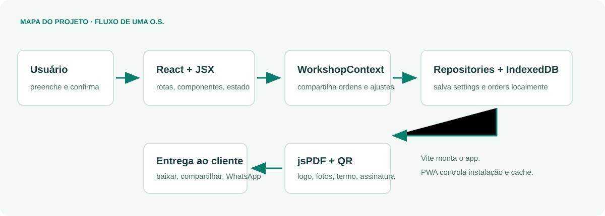
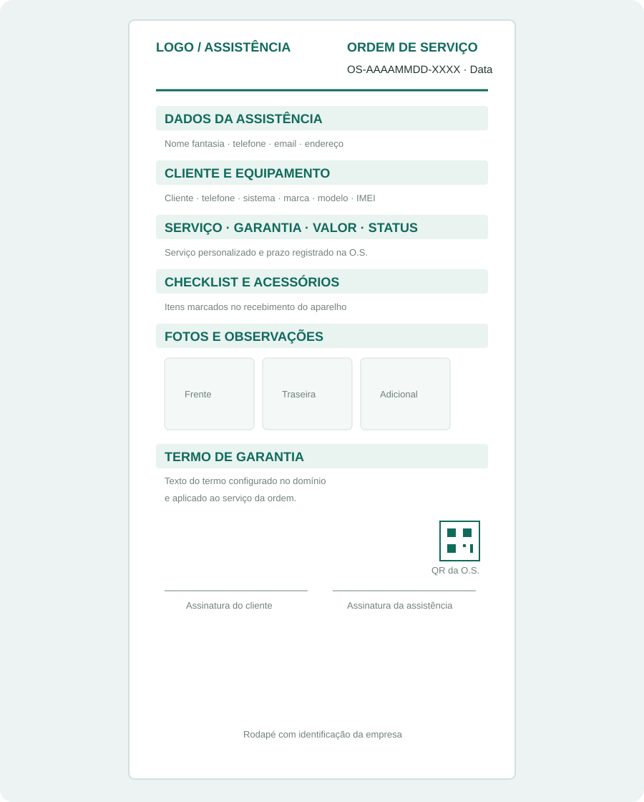
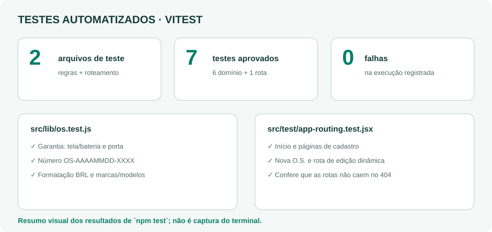
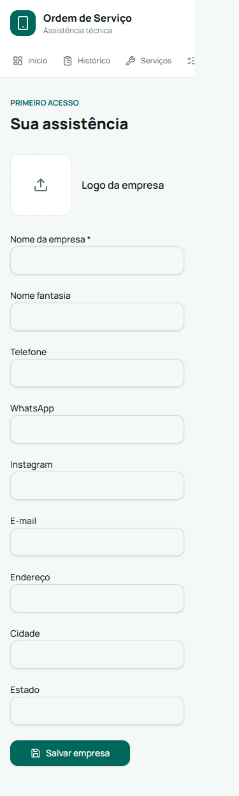
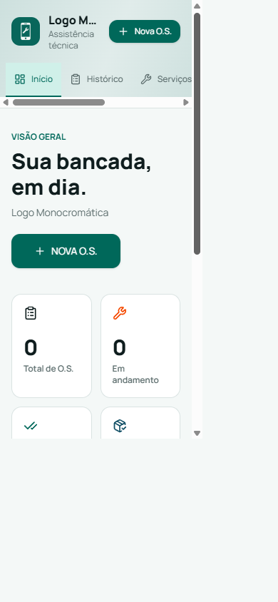
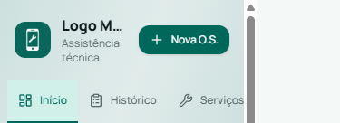
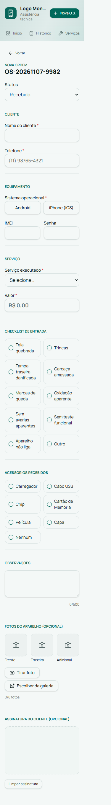
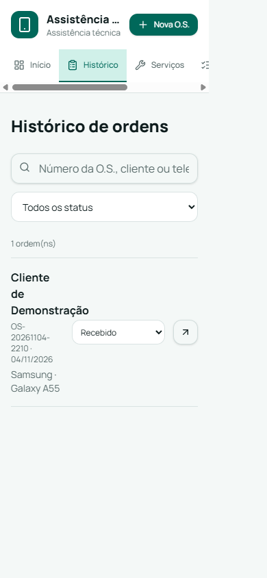

# Manual de Estudo do Projeto

**Aplicação:** Ordem de Serviço para assistência técnica de celulares  
**Público:** quem conhece HTML, CSS e JavaScript básico e está aprendendo React  
**Atualizado em:** 7 de novembro de 2026

> Este guia descreve o código que existe hoje. As imagens de interface foram capturadas em uma origem local isolada (`127.0.0.1:8086`) com empresa e O.S. fictícias; nenhum dado das outras origens foi usado. `testes-vitest.svg` é um resumo gráfico do resultado real de `npm test`, não uma captura do terminal. A tela embutida de prévia do PDF não foi tratada como imagem do documento: o layout do PDF está representado esquematicamente em `estrutura-pdf.svg`.

## Como usar este manual

1. Abra este Markdown no VS Code e use **Ctrl+Shift+V** para a visualização formatada.
2. Mantenha a pasta `docs/imagens/` junto deste arquivo; as imagens usam caminhos relativos.
3. Para estudar com o código aberto, siga os links para `src/` e avance pelo roteiro no final.
4. Para compartilhar ou imprimir, use a visualização Markdown do VS Code e a função de impressão do sistema; confira as quebras de página e a escala das imagens.

## 1. Objetivo e visão geral

O sistema ajuda uma assistência técnica a registrar aparelhos recebidos, acompanhar o status do reparo e entregar uma Ordem de Serviço em PDF. A prioridade de produto é rapidez: os campos são organizados por blocos curtos, vários itens vêm de catálogos editáveis e o telefone/valor são formatados durante a digitação.

O fluxo normal é: configurar a empresa no primeiro acesso; iniciar uma O.S.; preencher cliente, equipamento, serviço, valor e informações opcionais; validar; salvar no armazenamento local; gerar PDF; então baixar, compartilhar ou abrir o WhatsApp com uma mensagem pronta. O histórico permite buscar ordens e mudar status. Os dados ficam no navegador atual, não em uma conta remota.



### Tecnologias e responsabilidades

| Tecnologia                  | Papel neste projeto                                                       |
| --------------------------- | ------------------------------------------------------------------------- |
| JavaScript e JSX            | Linguagem da aplicação e sintaxe declarativa da interface React.          |
| React 19                    | Componentes, props, estado, efeitos, contexto e atualização da interface. |
| TanStack Start/Router       | SSR, rotas baseadas em arquivos, navegação e renderização das páginas.    |
| Vite 8                      | Servidor de desenvolvimento, transformação de módulos e build.            |
| Tailwind CSS 4              | Estilos utilitários; tokens semânticos são definidos em `src/styles.css`. |
| IndexedDB (`idb`)           | Persistência local assíncrona de configurações e O.S.                     |
| jsPDF                       | Desenho do documento A4 e saída como `Blob`.                              |
| `qrcode`                    | Conversão do identificador/link da O.S. em imagem QR para o PDF.          |
| `vite-plugin-pwa` / Workbox | Geração do Service Worker e definição de cache.                           |
| Radix UI, Lucide, Sonner    | Primitivos acessíveis, ícones e notificações.                             |

O Vite conecta os plugins e transforma o código; o Router decide qual rota renderizar; React compõe os componentes; o contexto compartilha dados carregados pelos repositórios; os serviços e bibliotecas cuidam de operações específicas, como imagens e PDF. Tailwind estiliza os elementos, e o PWA acrescenta instalação/cache sem substituir a aplicação React.

### Fluxo de dados atual

```text
URL → módulo em routes/ → página em pages/ → componentes de interface
    → useWorkshop() → WorkshopContext → repository → IndexedDB
```

Uma rota do TanStack Start seleciona uma página em `src/pages/`. A página compõe componentes de interface e combina estado local (por exemplo, busca no histórico) com o estado compartilhado do contexto. O contexto carrega e salva por meio dos repositories; telas e componentes não acessam o IndexedDB diretamente. Operações especializadas seguem caminhos próprios: `OrderPhotosSection` chama `services/images.js` para processar fotos e `OrderEditorPage` carrega `lib/pdf.js` para gerar o documento; `lib/os.js` mantém regras e validações independentes de React.

## 2. Estrutura de pastas

| Pasta                | Responsabilidade e exemplos                                                                                       | O que evitar e como se relaciona                                                                                                      |
| -------------------- | ----------------------------------------------------------------------------------------------------------------- | ------------------------------------------------------------------------------------------------------------------------------------- |
| `src/`               | Código-fonte do app, estilos, rotas e módulos.                                                                    | Evite duplicar responsabilidades entre pastas; os imports partem daqui.                                                               |
| `src/components/`    | Peças de interface e composição: CatalogEditor, OrderList, SignaturePad, OrderPhotosSection e WorkshopShell.      | Evite concentrar persistência e regra de negócio em componentes grandes; páginas usam `contexts`, `lib`, `services` e `repositories`. |
| `src/components/ui/` | Controles reutilizáveis de interface, muitos baseados em Radix.                                                   | Não devem conhecer clientes, O.S. ou IndexedDB. Componentes de aplicação compõem esses controles.                                     |
| `src/pages/`         | Telas de produto: DashboardPage, HistoryPage, CompanySettingsPage, ServicesPage, ChecklistPage e OrderEditorPage. | Compõem componentes e estado da tela; não substituem `routes/`, que é necessário ao TanStack Start.                                   |
| `src/hooks/`         | Hooks customizados, atualmente `useIsMobile`.                                                                     | Não colocar efeitos visuais genéricos dentro de repositórios; hooks podem ser compartilhados por componentes.                         |
| `src/services/`      | Operações de imagem: compressão de uploads e extração da paleta da logo.                                          | Não deve guardar estado React nem decidir a interface; telas chamam o serviço e atualizam seus dados.                                 |
| `src/repositories/`  | Acesso a dados; `storage.js` contém provider e repositórios IndexedDB.                                            | Evite SQL/IndexedDB direto em telas. Contexto e repositórios separam componentes do mecanismo de armazenamento.                       |
| `src/utils/`         | **Não existe.** `cn` está em `src/lib/utils.js`; regras de O.S. em `src/lib/os.js`.                               | No futuro, helpers genéricos podem ir para `utils`, mas regras do domínio devem continuar em módulo de domínio.                       |
| `src/contexts/`      | Estado compartilhado da oficina em `WorkshopContext.jsx`.                                                         | Evite colocar todo estado efêmero aqui; formulário e filtros locais continuam nas telas.                                              |
| `src/assets/`        | **Não existe.** Assets importados pelo código podem ser organizados aqui.                                         | Ícones e manifest atuais ficam em `public/`; não duplique recursos.                                                                   |
| `src/routes/`        | Adaptadores TanStack: declaram URLs, parâmetros e apontam para páginas.                                           | A árvore `routeTree.gen.js` é gerada; não editar manualmente.                                                                         |
| `src/lib/`           | Regras puras de O.S., PDF, utilitários, Service Worker e captura de erros.                                        | Evite UI aqui; componentes chamam a lógica exportada.                                                                                 |
| `public/`            | Manifest, ícones e arquivos servidos sem import.                                                                  | Não colocar lógica React.                                                                                                             |
| `docs/imagens/`      | Capturas locais e diagramas deste manual.                                                                         | As capturas usam dados sintéticos e não representam dados de cliente.                                                                 |

O `tsconfig.json` permanece por exigência do wrapper Vite/Lovable para resolver o alias `@`; contém `noEmit` e `paths`, mas não é fonte da aplicação. Os arquivos de aplicação são JavaScript/JSX.

## 3. Rotas e componentes de aplicação

### Mapa de páginas

| Arquivo de rota                 | URL                | Página/componente principal                            |
| ------------------------------- | ------------------ | ------------------------------------------------------ |
| `src/routes/index.jsx`          | `/`                | `pages/DashboardPage.jsx`                              |
| `src/routes/historico.jsx`      | `/historico`       | `pages/HistoryPage.jsx`                                |
| `src/routes/servicos.jsx`       | `/servicos`        | `pages/ServicesPage.jsx` → CatalogEditor               |
| `src/routes/checklist.jsx`      | `/checklist`       | `pages/ChecklistPage.jsx` → CatalogEditor              |
| `src/routes/configuracoes.jsx`  | `/configuracoes`   | `pages/CompanySettingsPage.jsx`                        |
| `src/routes/ordens.nova.jsx`    | `/ordens/nova`     | `pages/OrderEditorPage.jsx` sem número                 |
| `src/routes/ordens.$numero.jsx` | `/ordens/:numero`  | `pages/OrderEditorPage.jsx` com número da O.S.         |
| `src/routes/__root.jsx`         | raiz compartilhada | Providers, Shell, Outlet, metadados e fallback de erro |

### Componentes de produto

| Componente e arquivo                                                                               | Props                                                                                  | Estado, eventos e dependências                                                                                                                                                                                                                       | Fluxo, boas práticas e evolução                                                                                                                                                                    |
| -------------------------------------------------------------------------------------------------- | -------------------------------------------------------------------------------------- | ---------------------------------------------------------------------------------------------------------------------------------------------------------------------------------------------------------------------------------------------------- | -------------------------------------------------------------------------------------------------------------------------------------------------------------------------------------------------- |
| **DashboardPage** — [DashboardPage.jsx](../src/pages/DashboardPage.jsx)                            | Nenhuma prop própria.                                                                  | Não tem estado local; lê `orders/settings` de `useWorkshop`. Usa `resumoOrdens`, `OrderList`, Router, ícones e Button.                                                                                                                               | Calcula os quatro indicadores e passa as seis ordens mais recentes à lista. O cálculo fica fora do JSX. Pode evoluir com filtros/relatórios sem mover as regras para a tela.                       |
| **OrderEditorPage** — [OrderEditorPage.jsx](../src/pages/OrderEditorPage.jsx)                      | `numero` opcional: ausente cria; presente procura uma ordem para edição.               | Mantém `os`, `editing`, `savedSignature`, `logo`, `pdf`, `busy`, `outraMarca`; `sig` é ref. Coordena campos, assinatura, salvar e PDF; delega fotos a `OrderPhotosSection`. Depende do contexto, regras de O.S., componentes de UI, Sonner e Router. | `validar` → `persist` → `saveOrder` → `gerarPDF`; prévia expõe baixar, share nativo, WhatsApp, editar e nova O.S. O cleanup revoga URL temporária. A tela foi reduzida extraindo a seção de fotos. |
| **OrderPhotosSection** — [OrderPhotosSection.jsx](../src/components/orders/OrderPhotosSection.jsx) | `photos` e `onPhotosChange`, estado controlado pela página.                            | Exibe slots fixos, fotos extras, câmera/galeria, limite e remoção. Processa arquivos por `services/images.js` e valida o limite de oito fotos.                                                                                                       | Mantém a lista de fotos na página pai e concentra a interface e as interações relacionadas a fotos. Testes cobrem substituição no limite e bloqueio de anexos adicionais.                          |
| **HistoryPage** — [HistoryPage.jsx](../src/pages/HistoryPage.jsx)                                  | Nenhuma prop própria.                                                                  | Estados `search/status`; eventos `onChange` controlam campo e status. Lê ordens do contexto, usa `buscarOrdens` e `OrderList`.                                                                                                                       | Filtra localmente e deriva `filtered`, sem duplicar resultado em estado. Pode ganhar paginação/exportação em grandes volumes.                                                                      |
| **OrderList** — [OrderList.jsx](../src/components/OrderList.jsx)                                   | `orders`, lista já filtrada/ordenada pelo consumidor.                                  | Sem estado próprio. Select chama `saveOrder` para mudar status; link navega para edição; toasts comunicam sucesso/erro.                                                                                                                              | Tem estado vazio, links acessíveis e `key={order.numero}`. Futuro: ações PDF/compartilhamento, confirmação para exclusão.                                                                          |
| **CompanySettingsPage** — [CompanySettingsPage.jsx](../src/pages/CompanySettingsPage.jsx)          | Nenhuma prop própria.                                                                  | Estados `company` (rascunho) e `busy`; upload chama `imageFromFile` e `extractLogoPalette`, remover limpa logo/paleta e submit salva ambos.                                                                                                          | A paleta é extraída do arquivo original, sem alterar a imagem usada no PDF. Futuro: permitir ajustar as cores manualmente e visualizar a prévia antes de salvar.                                   |
| **CatalogEditor** — [CatalogEditor.jsx](../src/components/CatalogEditor.jsx)                       | `kind`: `services` ou `checklist`.                                                     | `entry` controla edição, `removing` controla confirmação, `busy` sinaliza operação. Botões Adicionar/Editar/Excluir e formulário chamam `saveSettings`.                                                                                              | Reutiliza a mesma tela para dois catálogos, valida nome duplicado e dias de garantia. Futuro: validação explícita de `kind`, testes do repositório e formulário menor.                             |
| **WorkshopShell** — [WorkshopShell.jsx](../src/components/WorkshopShell.jsx)                       | `children`, conteúdo da rota.                                                          | Não guarda estado próprio. Usa efeito para redirecionar primeiro acesso; reage a `settings`, `error` e localização.                                                                                                                                  | Centraliza identidade, navegação, loading, erro e acesso inicial. As cores da logo formam um gradiente diagonal intenso com brilho radial; cores de fallback evitam cabeçalho sem gradiente.       |
| **SignaturePad** — [SignaturePad.jsx](../src/components/SignaturePad.jsx)                          | Ref imperativa; o editor passa também `initialValue`, mas o componente atual não o lê. | `canvas`, `drawing`, `hasInk` são refs; pointer events iniciam, desenham e encerram traço. Expõe `clear()` e `toDataURL()` com `useImperativeHandle`.                                                                                                | Ref evita render a cada movimento do lápis. O efeito ajusta resolução ao DPR e remove listener no cleanup. Melhoria importante: restaurar `initialValue` e testar touch/resize.                    |
| **RootComponent/RootShell** — [__root.jsx](../src/routes/__root.jsx)                               | `children` no Shell, contexto de Router no Root.                                       | `RootComponent` usa efeito para registrar SW uma vez. Provider React Query, WorkshopProvider, Shell, Outlet e Toaster envolvem páginas.                                                                                                              | É a integração comum. O `QueryClient` é criado dentro de render; seria melhor mantê-lo estável para evitar recriações.                                                                             |
| **ErrorComponent/NotFoundComponent** — [__root.jsx](../src/routes/__root.jsx)                      | Props fornecidas pelo Router, como `error/reset`.                                      | ErrorComponent usa `error` como dependência do efeito de relatório; botão invalida Router e tenta de novo.                                                                                                                                           | Mantém feedback de erro e navegação 404 fora das telas de negócio.                                                                                                                                 |

### Primitivos de UI

Todos ficam em `src/components/ui/`. O padrão comum é aceitar props do elemento/Radix, `className`, `children`, props de estado (`value/defaultValue`, `disabled`) e callbacks (`onClick`, `onValueChange`, `onSelect`), encaminhando `ref` quando apropriado. O consumidor controla o estado quando precisa; Radix/Embla/DayPicker controlam detalhes de foco, teclado e interação.

| Arquivo               | Exports e responsabilidade                                                                                                                                                |
| --------------------- | ------------------------------------------------------------------------------------------------------------------------------------------------------------------------- |
| `accordion.jsx`       | Accordion, Item, Trigger, Content: seções expansíveis.                                                                                                                    |
| `alert-dialog.jsx`    | AlertDialog, Portal, Overlay, Trigger, Content, Header/Footer, Title/Description, Action/Cancel: confirmação modal.                                                       |
| `alert.jsx`           | Alert, Title, Description: aviso estático.                                                                                                                                |
| `aspect-ratio.jsx`    | AspectRatio: mantém proporção visual.                                                                                                                                     |
| `avatar.jsx`          | Avatar, Image, Fallback: identidade visual.                                                                                                                               |
| `badge.jsx`           | Badge e `badgeVariants`: etiqueta e variantes.                                                                                                                            |
| `breadcrumb.jsx`      | Breadcrumb, List, Item, Link, Page, Separator, Ellipsis: trilha hierárquica.                                                                                              |
| `button.jsx`          | Button e `buttonVariants`: botão comum e polimórfico com Slot.                                                                                                            |
| `calendar.jsx`        | Calendar, CalendarDayButton: calendário baseado em DayPicker; foco muda em efeito quando `modifiers` mudam.                                                               |
| `card.jsx`            | Card, Header, Footer, Title, Description, Content: estrutura de painel.                                                                                                   |
| `carousel.jsx`        | Carousel, Content, Item, Previous, Next: carrossel Embla; estado de navegação e listeners são sincronizados em efeitos.                                                   |
| `chart.jsx`           | ChartContainer, Tooltip/TooltipContent, Legend/LegendContent, ChartStyle: adaptação de Recharts e contexto.                                                               |
| `checkbox.jsx`        | Checkbox: seleção booleana Radix.                                                                                                                                         |
| `collapsible.jsx`     | Collapsible, Trigger, Content: conteúdo recolhível.                                                                                                                       |
| `command.jsx`         | Command, Dialog, Input, List, Empty, Group, Item, Shortcut, Separator: paleta de comandos.                                                                                |
| `context-menu.jsx`    | ContextMenu, Trigger, Content, Item, CheckboxItem, RadioItem/Group, Label, Separator, Group, Portal, Sub, Shortcut: menu contextual.                                      |
| `dialog.jsx`          | Dialog, Portal, Overlay, Trigger, Close, Content, Header/Footer, Title/Description: modal.                                                                                |
| `drawer.jsx`          | Drawer, Portal, Overlay, Trigger, Close, Content, Header/Footer, Title/Description: painel móvel baseado em Vaul.                                                         |
| `dropdown-menu.jsx`   | DropdownMenu, Trigger, Content, Item, Checkbox/Radio, Label, Separator, Group, Portal, Sub, Shortcut: menu de ações.                                                      |
| `form.jsx`            | Form, FormField, FormItem, FormLabel, FormControl, FormDescription, FormMessage, `useFormField`: integra React Hook Form e IDs/erros acessíveis.                          |
| `hover-card.jsx`      | HoverCard, Trigger, Content: conteúdo ao apontar/focar.                                                                                                                   |
| `input-otp.jsx`       | InputOTP, Group, Slot, Separator: entrada de código segmentado.                                                                                                           |
| `input.jsx`           | Input: input nativo com estilo e ref.                                                                                                                                     |
| `label.jsx`           | Label: rótulo compatível com Radix.                                                                                                                                       |
| `menubar.jsx`         | Menubar, Menu, Trigger, Content, Item, Separator, Label, Checkbox/Radio, Portal, Sub, Group, Shortcut: barra de menus.                                                    |
| `navigation-menu.jsx` | NavigationMenu, List, Item, Content, Trigger, Link, Viewport, Indicator e estilo: navegação expansível.                                                                   |
| `pagination.jsx`      | Pagination, Content, Link, Item, Previous, Next, Ellipsis: controles de páginas.                                                                                          |
| `popover.jsx`         | Popover, Trigger, Content, Anchor: conteúdo flutuante.                                                                                                                    |
| `progress.jsx`        | Progress: indicador numérico.                                                                                                                                             |
| `radio-group.jsx`     | RadioGroup, RadioGroupItem: escolha exclusiva.                                                                                                                            |
| `resizable.jsx`       | ResizablePanelGroup, Panel, Handle: painéis ajustáveis.                                                                                                                   |
| `scroll-area.jsx`     | ScrollArea, ScrollBar: área rolável estilizada.                                                                                                                           |
| `select.jsx`          | Select, Group, Value, Trigger, Content, Label, Item, Separator, botões de rolagem: seleção customizada.                                                                   |
| `separator.jsx`       | Separator: divisor visual/semântico.                                                                                                                                      |
| `sheet.jsx`           | Sheet, Portal, Overlay, Trigger, Close, Content, Header/Footer, Title/Description: painel lateral.                                                                        |
| `sidebar.jsx`         | SidebarProvider, Sidebar, Content, Header/Footer, Group, Menu, Button, Trigger, Rail, Input, Skeleton, Separator e `useSidebar`: layout lateral controlável e responsivo. |
| `skeleton.jsx`        | Skeleton: placeholder de carregamento.                                                                                                                                    |
| `slider.jsx`          | Slider: valor em intervalo.                                                                                                                                               |
| `sonner.jsx`          | Toaster: região visual das notificações Sonner.                                                                                                                           |
| `switch.jsx`          | Switch: alternância booleana.                                                                                                                                             |
| `table.jsx`           | Table, Header, Body, Footer, Head, Row, Cell, Caption: estrutura tabular.                                                                                                 |
| `tabs.jsx`            | Tabs, List, Trigger, Content: painel com abas.                                                                                                                            |
| `textarea.jsx`        | Textarea: área de texto.                                                                                                                                                  |
| `toggle-group.jsx`    | ToggleGroup, ToggleGroupItem: botões de modo/seleção agrupados.                                                                                                           |
| `toggle.jsx`          | Toggle e `toggleVariants`: botão liga/desliga visual.                                                                                                                     |
| `tooltip.jsx`         | Tooltip, Provider, Trigger, Content: dica contextual.                                                                                                                     |

O kit é amplo, mas várias peças não aparecem nas telas atuais. Evite escolher um componente só porque existe: use-o quando o padrão visual/comportamental realmente se encaixar.

## 4. Hooks, estado e efeitos

### Hooks customizados

| Hook                                                                        | Problema resolvido e uso                                                                                                                                                                                       |
| --------------------------------------------------------------------------- | -------------------------------------------------------------------------------------------------------------------------------------------------------------------------------------------------------------- |
| `useIsMobile` em [use-mobile.jsx](../src/hooks/use-mobile.jsx)              | Usa breakpoint de 768 px. Cria `matchMedia`, atualiza `isMobile`, registra `change` e remove o listener ao desmontar. É reutilizado pelo Sidebar; o padrão serve para encapsular uma fonte externa de eventos. |
| `useWorkshop` em [WorkshopContext.jsx](../src/contexts/WorkshopContext.jsx) | Dá acesso ao contexto compartilhado sem repetir `useContext(WorkshopContext)` em todas as telas. Deve ser chamado abaixo de `WorkshopProvider`.                                                                |
| `useSidebar`                                                                | Lê estado/contexto de Sidebar; lança erro descritivo se não estiver em `SidebarProvider`.                                                                                                                      |
| `useCarousel`                                                               | Fornece API, orientação e comandos ao conteúdo/controles do Carousel.                                                                                                                                          |
| `useChart`                                                                  | Recupera configuração de ChartContainer para tooltip/legenda.                                                                                                                                                  |
| `useFormField`                                                              | Combina contexto do FormField com item/estado do React Hook Form para gerar IDs, `aria-*` e mensagem.                                                                                                          |

Para criar hook: identificar lógica repetida ou integração com API do browser; escrever uma função `use...`; chamar hooks React apenas no topo; devolver dados e ações; definir setup/cleanup se houver listener; e usar o hook em componentes funcionais. Um hook customizado **não** compartilha automaticamente estado entre chamadas — para estado comum é necessário Context, store ou parâmetro externo.

### `useState` do produto

| Local            | Estado                                                                 | Quem altera/consome                                                                                     |
| ---------------- | ---------------------------------------------------------------------- | ------------------------------------------------------------------------------------------------------- |
| WorkshopProvider | `settings`, `orders`, `error`                                          | `load`, `saveSettings`, `saveOrder`; consumido pelo Shell e telas através do contexto.                  |
| CatalogEditor    | `entry`, `busy`, `removing`                                            | Adicionar, digitar, editar, iniciar/cancelar exclusão, salvar/excluir; consumido pelo formulário/lista. |
| CompanySettings  | `company`, `busy`                                                      | Inputs, upload, remoção da logo e submit; consumido pelo form e persistência.                           |
| History          | `search`, `status`                                                     | Digitação/seleção; gera lista filtrada apresentada por OrderList.                                       |
| OrderEditor      | `editing`, `savedSignature`, `os`, `logo`, `pdf`, `busy`, `outraMarca` | Inputs, seletores, fotos, ações e resultado do PDF; estado controla formulário ou tela de prévia.       |
| UI               | `canScrollPrev/Next` (Carousel), `openMobile/_open` (Sidebar)          | Eventos da biblioteca; distribuído por contextos internos.                                              |
| Hook/UI          | `isMobile`                                                             | Evento `matchMedia`; consumido por Sidebar.                                                             |

`useState(valorInicial)` retorna valor e setter. O setter agenda uma renderização; React compara a nova árvore e atualiza o DOM necessário. Para atualizar com base no estado anterior, o projeto usa a forma funcional `setX((anterior) => ...)`. Arrays/objetos devem ser substituídos, não mutados.

### `useEffect` e ciclo de vida

| Local             | Momento/dependências                                              | Motivo e cuidado                                                                                                              |
| ----------------- | ----------------------------------------------------------------- | ----------------------------------------------------------------------------------------------------------------------------- |
| WorkshopProvider  | Após montar; `[]`.                                                | Carrega configuração/ordens de IndexedDB. Tratar erro e loading; evitar duplicar chamadas sem necessidade.                    |
| WorkshopShell     | Montagem e mudanças em `[settings, location.pathname, navigate]`. | Envia primeira configuração para `/configuracoes`; redirecionamento deve ser idempotente.                                     |
| OrderEditor       | Cleanup ao trocar `pdf` ou desmontar; `[pdf]`.                    | Revoga `URL.createObjectURL` para liberar memória. Não revogar URL antes de o usuário baixar.                                 |
| SignaturePad      | Após montar; `[]`.                                                | Ajusta canvas ao tamanho/DPR e escuta resize; cleanup remove listener. Redimensionar limpa o desenho atual no código de hoje. |
| CalendarDayButton | Quando `modifiers` mudam.                                         | Move foco para o dia focado; dependência ampla pode causar efeitos extras, mas preserva integração com DayPicker.             |
| Carousel          | API/setApi e API/onSelect.                                        | Conecta a API Embla e sincroniza botões; limpar todo listener registrado, inclusive `reInit`.                                 |
| SidebarProvider   | `[toggleSidebar]`.                                                | Registra atalho Ctrl/Cmd+B e remove ao desmontar.                                                                             |
| RootComponent     | Após montar; `[]`.                                                | Chama `registerServiceWorker`; ocorre uma vez por montagem no browser.                                                        |
| ErrorComponent    | Quando `error` muda.                                              | Envia erro ao relatório; evita reportar renderizações sem erro novo.                                                          |
| useIsMobile       | Após montar; `[]`.                                                | Registra e remove o listener de breakpoint. Não acessar `window` durante render SSR.                                          |

Use efeito para sincronizar React com algo externo (DOM imperativo, browser API, rede, listener), não para calcular um valor derivável. Sempre pergunte: “qual recurso externo estou sincronizando?” e “qual é o cleanup?”.

## 5. JSX na prática

JSX parece HTML, mas é sintaxe JavaScript que React transforma em chamadas de criação de elementos. Atributos são `className` e `htmlFor`; eventos recebem funções; expressões JavaScript ficam entre chaves.

```jsx
{
  os.so === "Android" && (
    <Field label="Modelo" req>
      <Input value={os.modelo} onChange={(event) => set("modelo", event.target.value)} />
    </Field>
  );
}
```

`&&` mostra o campo somente quando o sistema é Android. Uma lista usa `.map()` e uma `key` estável:

```jsx
{
  STATUS.map((status) => <option key={status}>{status}</option>);
}
```

Props são dados passados do pai para o filho: `<OrderList orders={orders.slice(0, 6)} />`. Em `Chips`, o pai passa opções, seleção atual e callback; o filho sinaliza a escolha e o pai atualiza estado. Essa direção explícita facilita seguir o fluxo.

## 6. Fluxo de dados de uma O.S.


| Etapa           | O que acontece                                                                                                 | Código para estudar                                 |
| --------------- | -------------------------------------------------------------------------------------------------------------- | --------------------------------------------------- |
| 1. Usuário      | Digita, escolhe status/serviço, marca checklist/acessórios, anexa fotos ou desenha assinatura.                 | `OrderEditor.jsx`, `SignaturePad.jsx`               |
| 2. Formulário   | Inputs controlados recebem `value` e `onChange`; helpers formatam telefone e dinheiro enquanto digita.         | `formatPhone`, `formatBRLFromDigits` em `lib/os.js` |
| 3. Estado React | `os` é o objeto de trabalho; atualizações imutáveis notificam React para renderizar.                           | `useState`, helper local `set` no OrderEditor       |
| 4. Validação    | `validar(os)` retorna mensagem ou `null`; toast mostra erro sem bloquear o fluxo com alert nativo.             | `src/lib/os.js`                                     |
| 5. Persistência | Contexto delega a `OrderRepository`; IndexedDB armazena O.S. e lista é atualizada.                             | `WorkshopContext.jsx`, `repositories/storage.js`    |
| 6. PDF          | Usa a ordem já salva, snapshot da empresa, imagens, assinatura, termo, número/status e QR.                     | `src/lib/pdf.js`                                    |
| 7. Entrega      | Web Share API compartilha arquivo quando suportada; botão de WhatsApp abre link `wa.me`; alternativa é baixar. | OrderEditor, `mensagemWhatsApp`                     |

Salvar e gerar PDF são ações explícitas; o código atual não é autosave contínuo. `saveOrder` faz a persistência antes do PDF.

## 7. IndexedDB e repositórios

IndexedDB é uma base de dados assíncrona do browser que armazena registros estruturados e blobs/strings grandes melhor do que `localStorage`. O pacote `idb` fornece uma interface com Promises.

Em [storage.js](../src/repositories/storage.js), `StorageProvider.open()` abre a base `assistencia-os`, versão `1`. A store `settings` usa chave explícita `app`; `orders` usa `numero` como `keyPath`. `SettingsRepository.load()` devolve configuração salva ou cria configuração inicial (empresa não configurada, serviços e checklist padrão). `OrderRepository.list()` ordena por emissão; `save()` valida status, preenche metadados e busca colisões do número.

| Abstração            | Responsabilidade atual                 | Futuro remoto                                                  |
| -------------------- | -------------------------------------- | -------------------------------------------------------------- |
| `StorageProvider`    | Abrir/conservar conexão IndexedDB.     | Criar provider/adaptador Supabase/Firebase.                    |
| `SettingsRepository` | Carregar/salvar empresa e catálogos.   | Interface `load/save` implementada por backend.                |
| `OrderRepository`    | Listar/obter/salvar ordens localmente. | Interface `list/get/save` com auth, paginação e erros de rede. |

As abstrações ajudam, mas componentes ainda recebem métodos através de um contexto importando os repositórios concretos. Para trocar backend sem reescrever telas, formalize contratos, injete implementação no contexto e normalize erros/IDs. Antes do SaaS, acrescente autenticação, `tenantId`, autorização por registro, sincronização offline/conflitos, migração de dados, backups e política de privacidade. Não confiar apenas em filtro de empresa feito pelo browser: isolamento precisa ser garantido no backend.

## 8. PDF e imagens



`gerarPDF(order, logo, assinatura)` instancia jsPDF A4 em milímetros e desenha cabeçalho, linhas/seções, pares de campos, listas, observações, termo e rodapé. `ensureSpace()` cria nova página quando necessário. As fotos são dispostas em três colunas compactas, com proporção preservada, rótulos abaixo e espaçamento lateral reduzido; uma nova página só é criada quando a próxima linha não couber, mantendo o título junto à primeira linha de imagens. Quando há fotos, o termo de garantia começa em uma página nova depois de todas elas e seu texto é mantido inteiro na mesma página; sem fotos, permanece na página atual se couber e passa para a próxima se faltar espaço. O logo e fotos são adicionados com `addImage`; tamanho é limitado mantendo proporção. `imageFromFile()` valida tipo/tamanho, decodifica a imagem, reduz o lado maior e converte em JPEG, diminuindo o peso salvo no IndexedDB. A O.S. mantém três posições fixas (Frente, Traseira, Adicional) e permite anexar mais cinco; cada extra tem miniatura, nome e remoção própria. O limite total é oito fotos por ordem. O PDF percorre `order.fotos`, então extras são incluídas no mesmo fluxo de desenho.

No formulário, as fotos extras têm duas ações: **Tirar foto** usa `capture="environment"` como pedido para a câmera traseira; **Escolher da galeria** abre o seletor sem essa indicação. Os slots Frente/Traseira/Adicional continuam com captura direta. `capture` é uma sugestão ao navegador: Safari/iOS, Chrome/Android e outros navegadores podem apresentar fluxos diferentes. Para confirmar o comportamento, teste em aparelhos reais; o browser desktop não simula a câmera física.

Ao enviar uma logo, `extractLogoPalette()` amostra uma versão pequena do arquivo original, ignora transparência e pixels quase brancos e prioriza cores com croma para evitar que preto/cinza dominantes apaguem o efeito. Logos essencialmente monocromáticas recebem uma paleta teal/verde-água de fallback. `CompanySettings` salva as cores em `settings.empresa.logoPalette` junto da logo no IndexedDB. `WorkshopShell` valida os valores hexadecimais e usa as cores como extremos de um gradiente diagonal intenso, com brilho radial e fallbacks quando uma cor não está disponível. Sem logo, o cabeçalho mantém o estilo padrão; as cores do texto permanecem as do tema para preservar contraste.

O QR é criado por `QRCode.toDataURL(order.trackingUrl || order.numero, ...)` e inserido como PNG. Com `trackingUrl` vazio, o QR identifica a O.S. localmente, não abre um rastreio online. A assinatura do canvas chega como PNG a `addImage`; ausência de assinatura não impede criar PDF. A saída é `Blob`, convertida a URL temporária e mostrada em iframe. A captura automática do iframe do PDF não funcionou no browser integrado usado nesta documentação; por isso a imagem acima é um esquema, não render do documento.

Ponto de atenção no PDF: alguns textos de campos/empresa são cortados para a primeira linha; documentos com endereços/nomes longos devem ser verificados visualmente e ganhar quebra de linha onde necessário.

## 9. PWA

| Parte          | Implementação e leitura                                                                                                                                                      |
| -------------- | ---------------------------------------------------------------------------------------------------------------------------------------------------------------------------- |
| Manifest       | `public/manifest.webmanifest`: nome, ícones 192/512, `start_url`, `scope`, `display: standalone`, cor de fundo/tema.                                                         |
| Metadados      | Root declara viewport, `theme-color`, Apple web app e links de ícone/manifest.                                                                                               |
| Service Worker | `vite-plugin-pwa` com `generateSW`; `src/lib/register-sw.js` é o único registrador e registra apenas em produção.                                                            |
| Precache       | Build anterior observado: 40 entradas; assets gerados recebem cache para uso repetido. O número muda conforme o build.                                                       |
| Runtime cache  | Rotas de navegação: `NetworkFirst` com timeout de 3s; `/assets/`: `CacheFirst`.                                                                                              |
| Offline        | Cache melhora disponibilidade, mas `navigateFallback: null` e HTML fora do glob significam que acesso offline inicial/rotas profundas precisam ser testados, não presumidos. |
| Android        | Em deployment HTTPS compatível, navegador pode oferecer instalação; manifest/ícones e worker precisam carregar corretamente.                                                 |
| iPhone/iPad    | Normalmente Safari → Compartilhar → Adicionar à Tela de Início. Conferir ícone e modo standalone no aparelho.                                                                |

O worker recusa desenvolvimento, preview incorporado e domínios Lovable de preview para evitar cache antigo. Lighthouse >90 e instalação real em aparelhos **não foram medidos**. Para validar PWA, teste HTTPS, manifest, ícones, instalação, atualização do worker, abrir após primeiro cache e fluxo offline em rede desligada.

## 10. Testes e como interpretar



Comando: `npm test` (executa `vitest run`). Baseline antes da reorganização de páginas, em 7 de novembro de 2026: **3 arquivos, 13 testes passaram**. Após criar `pages/` e extrair a seção de fotos: **4 arquivos, 15 testes passaram**. `npm run lint` não reportou erros e manteve 7 avisos de Fast Refresh em componentes existentes; `npm run build` concluiu com sucesso.

| Arquivo                                             | O que verifica                                                                                                 | Limite atual                                                                                          |
| --------------------------------------------------- | -------------------------------------------------------------------------------------------------------------- | ----------------------------------------------------------------------------------------------------- |
| `src/lib/os.test.js`                                | Garantia padrão/personalizada, formato numérico, valor BRL, marcas/modelos e limite configurado de oito fotos. | Não verifica componente, IndexedDB, seleção/remoção de fotos, assinatura, PDF nem validação completa. |
| `src/lib/pdf.test.js`                               | Quebra do termo com/sem fotos e organização das imagens em três colunas.                                       | Usa jsPDF simulado; não valida a renderização visual final em leitor de PDF.                          |
| `src/components/orders/OrderPhotosSection.test.jsx` | Substituição de slot fixo no limite e bloqueio de anexo acima do limite.                                       | Não testa APIs reais de câmera/galeria, remoção nem interação em aparelho.                            |
| `src/test/app-routing.test.jsx`                     | Início, histórico, serviços, checklist, configurações, O.S. nova e caminho dinâmico não caem no 404.           | Apenas match de rota; não monta tela nem testa navegação real.                                        |

Teste automatizado é um programa que confere expectativas repetíveis. Um `expect(valor).toBe(...)` expressa o resultado desejado. A suíte cobre o limite configurado, substituição de slot fixo, bloqueio no limite, regras do PDF e correspondência das rotas. A remoção de fotos, APIs reais de câmera/galeria, IndexedDB, extração da paleta, assinatura e fluxo offline ainda precisam de cobertura automatizada ou teste manual em aparelho/navegador. Suíte verde reduz regressões, mas não prova que o produto todo está correto.

## 11. Execução local

Requer Node.js e dependências instaladas (`npm install`).

```sh
npm run dev       # servidor local de desenvolvimento
npm test          # testes Vitest uma vez
npm run lint      # ESLint
npm run build     # build de produção, SSR e worker PWA
npm run preview   # visualizar build, se suportado pelo ambiente
```

O wrapper Lovable mostra aviso informativo de que `vite-tsconfig-paths` também poderia ser substituído pelo resolvedor nativo de Vite; não é, por si só, falha de aplicação. Configuração de alias `@` está em `tsconfig.json` por compatibilidade com esse wrapper e `noEmit: true` evita o TypeScript sobrescrever fontes JavaScript.

## 12. Escalabilidade e melhorias priorizadas

**Preparado:** regras de O.S. separadas da interface; repositories encapsulam acesso a dados; configurações/serviços/checklist são dados; serviço de imagem e gerador PDF têm módulos próprios; status e garantia podem crescer; `trackingUrl` já existe como campo.

**Ainda precisa:** contratos explícitos de repository e injeção de provider; autenticação/tenant; sincronização e conflitos; gestão de migrations/versionamento IndexedDB; testes de integração; política de segurança para senha/IMEI; fluxo de export/backup; política de tamanho/limpeza de imagens.

| Etapa futura      | Trabalho necessário                                                                                                                                     |
| ----------------- | ------------------------------------------------------------------------------------------------------------------------------------------------------- |
| Supabase/Firebase | Definir contrato JS para orders/settings, implementar adapter remoto, manter IndexedDB como cache/fila offline se necessário, tratar retries/conflitos. |
| Autenticação      | Login, sessão/expiração, autorização por usuário e testes de acesso negado. Nunca colocar segredo privilegiado no bundle client.                        |
| SaaS multiempresa | Empresas como tenants; usuários com vínculo e papéis; `tenantId` em cada registro; regras RLS/backend; índices e logs; importação/exportação de dados.  |
| Operação          | Monitoramento de falhas, backup/restauração, limites de foto, consentimento e retenção de IMEI/senha.                                                   |

## 13. Roteiro de estudos com o código

| Ordem | Tema                  | Exercício de leitura/prática                                                                                                  |
| ----: | --------------------- | ----------------------------------------------------------------------------------------------------------------------------- |
|     1 | JavaScript            | Siga `gerarNumeroOS`, `numeroUnico`, `formatPhone` e `validar` em `src/lib/os.js`; identifique parâmetros, arrays e retornos. |
|     2 | JSX                   | Leia uma condição `os.so === ... && ...` e um `.map()` em `OrderEditor.jsx`.                                                  |
|     3 | Componentização       | Entenda `Card`, `Field`, `Chips`, `Dashboard` e `OrderList`.                                                                  |
|     4 | Props                 | Trace `{ orders }` de Dashboard até OrderList e `{ kind }` até CatalogEditor.                                                 |
|     5 | Eventos               | Trace `onChange` do input de valor até o setter e o formato BRL.                                                              |
|     6 | useState              | Veja `os` como fonte de verdade; compare com `search` local do History.                                                       |
|     7 | useEffect             | Estude carga inicial, cleanup da URL do PDF e listener do canvas.                                                             |
|     8 | Context API           | Siga `WorkshopProvider` → `useWorkshop` → Dashboard/Editor.                                                                   |
|     9 | Hooks customizados    | Leia `useIsMobile` linha por linha; observe setup, estado e cleanup.                                                          |
|    10 | IndexedDB             | Acompanhe `OrderEditor.persist()` até `OrderRepository.save()`.                                                               |
|    11 | PWA                   | Leia manifest, `vite.config.js` e `register-sw.js`; valide em deployment HTTPS.                                               |
|    12 | Arquitetura front-end | Desenhe dependências entre routes, components, context, repositories, services e lib.                                         |

## 14. Capturas e ilustrações

| Imagem                                                                         | O que mostra                                                                       |
| ------------------------------------------------------------------------------ | ---------------------------------------------------------------------------------- |
|                      | Formulário de configuração sem nome da empresa.                                    |
|                          | Dashboard com logo/paleta de demonstração e sem ordens cadastradas.                |
|                   | Recorte do cabeçalho com o gradiente derivado da logo de demonstração.             |
|                              | Formulário em viewport de 390 px, agora com ações separadas para câmera e galeria. |
|  | Histórico com uma ordem sintética.                                                 |
|                                         | Diagrama didático do fluxo, não screenshot.                                        |
|                                  | Wireframe do PDF, não render do arquivo gerado.                                    |
|                                 | Infográfico baseado no resultado de Vitest, não screenshot do terminal.            |

As capturas recentes foram feitas na origem de teste local `127.0.0.1:8086`; IndexedDB é isolado por origem. Os registros usados são sintéticos e as outras abas/origens não foram alteradas. Para gerar manual em PDF, imprima a visualização Markdown e confira imagens/cortes antes de distribuir.
